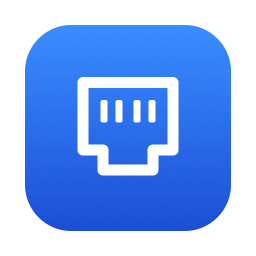

# Netbar

A menu bar icon that shows whether your Mac is using Ethernet or Wi-Fi.

A MacBook keeps Wi-Fi connected when you plug in Ethernet, so the Wi-Fi icon stays lit and you can't tell which one your traffic is actually going over. Netbar shows the connection macOS is using right now:

| Icon | Meaning |
| --- | --- |
| `cable.connector.horizontal` | Ethernet |
| `wifi` | Wi-Fi |
| `network` | Something else (for example a VPN or iPhone USB) |
| `wifi.slash` | No connection |

Click it to see the interface name (for example `Ethernet (en7)`), turn on **Open at Login**, or quit.

## Install

```sh
brew install --cask kombuchelada/tap/netbar
```

Or download `Netbar-<version>.pkg` from [Releases](../../releases) and open it. The installer puts Netbar in Applications and starts it. Prefer not to use an installer? Download `Netbar-<version>.zip` instead, unzip it, and move **Netbar.app** to Applications.

Releases, including the installer, are signed with a Developer ID and notarized by Apple, so they open like any other download.

To uninstall, quit Netbar and move it to the Trash. If you used the installer, you can also remove its receipt with `sudo pkgutil --forget io.github.kombuchelada.netbar.pkg`.

Requires macOS 14 Sonoma or later.

## Build from source

Requires Xcode 16 or later, or just the Xcode Command Line Tools.

```sh
./scripts/build-app.sh --install   # builds build/Netbar.app and copies it to ~/Applications
```

### Releases

Releases are signed with Developer ID Application and Developer ID Installer certificates and notarized. With both certificates in your keychain and notarization credentials saved via `xcrun notarytool store-credentials <profile>`:

```sh
SIGN_IDENTITY="Developer ID Application: Your Name (TEAMID)" \
INSTALLER_IDENTITY="Developer ID Installer: Your Name (TEAMID)" \
NOTARY_PROFILE=<profile> ./scripts/build-app.sh --notarize --pkg
```

This builds, signs with the hardened runtime, notarizes, staples the ticket and writes `build/Netbar-<version>.zip`, printing the values for the Homebrew cask. `--pkg` also wraps the app in `build/Netbar-<version>.pkg` with `scripts/make-pkg.sh`, notarized and stapled too. The installer always installs into `/Applications`, for all users, then opens Netbar for the user at the screen (`Resources/pkg/postinstall`). Attach both files to the GitHub release.

## How it works

Netbar uses `NWPathMonitor` from Apple's Network framework, which reports the path macOS uses by default for outgoing traffic. It updates as soon as that path changes. It doesn't poll and doesn't need any permissions.
